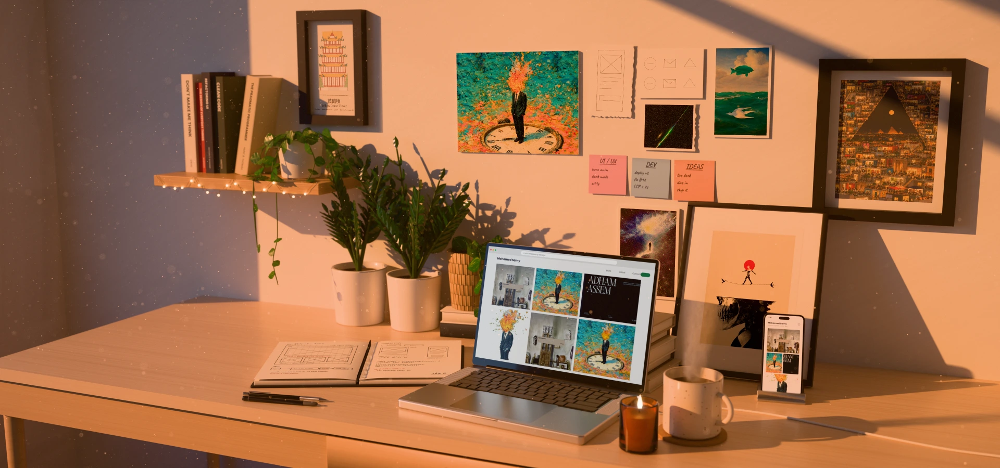
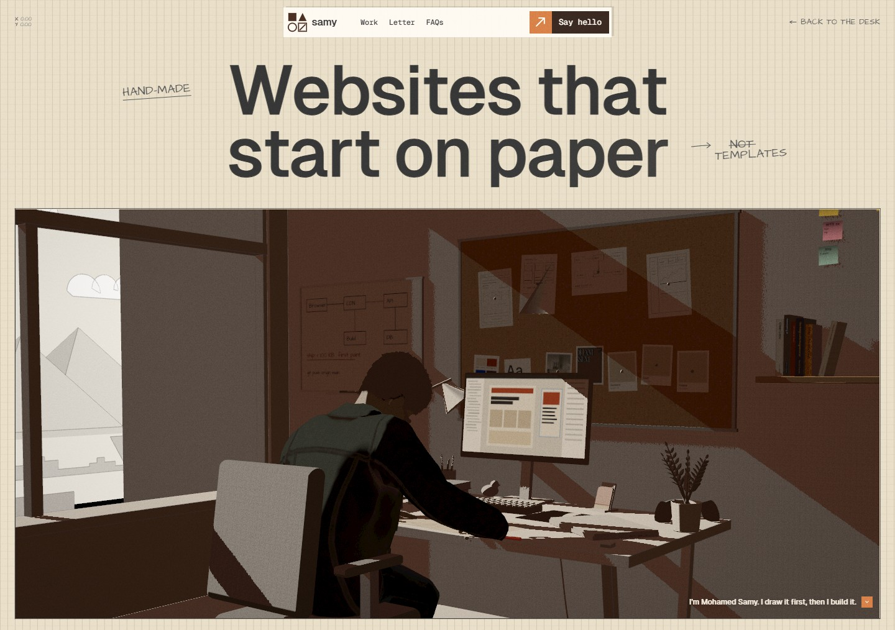

# Mohamed Samy — portfolio

**Live:** [mohamed-samy-portfolio.vercel.app](https://mohamed-samy-portfolio.vercel.app)



My portfolio is a room: a sunlit desk with my work open on the laptop and the phone, prints on the wall, and a notebook of wireframes. Press **Enter** and the camera dives into the laptop, into a second site where the story is told by a 3D character drawing, building and shipping a website as you scroll.



## How it is made

- **The room** is modelled in Blender and rendered in Cycles. The site plays a seamless video loop of it, with stills at 1280–3840 px, and draws the laptop and phone screens live on top (`src/desk-site/`).
- **The dive** into the laptop is a scroll- and key-driven camera move into the screen (`src/desk-site/dive.js`).
- **The inside site** (`inside.html`, `src/inside/`) is three.js. Animation clips authored in Blender are scrubbed by the scroll position, and a paper-and-ink look comes from baked light and outline shaders.
- **Tools** (`tools/`): the Blender pipeline that lays out, renders, denoises and encodes the room, plus Chrome DevTools Protocol scripts that measure frame time and Core Web Vitals before every deploy.

## Stack

Vite · three.js · three-gpu-pathtracer · Blender (Cycles) · ffmpeg · Vercel

## Run it

```bash
npm install
npm run dev
```

The rendered room loops in `public/desk/final/` are committed. The raw render passes are not; `tools/` rebuilds them from Blender.
